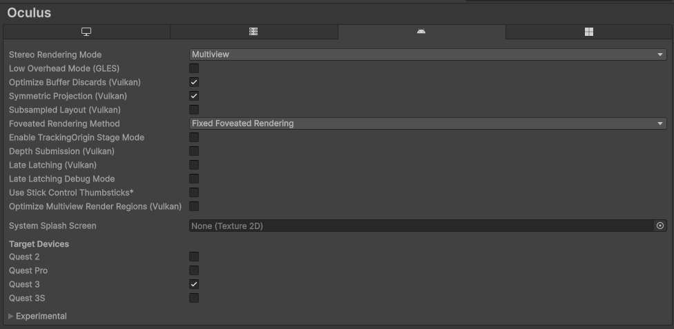
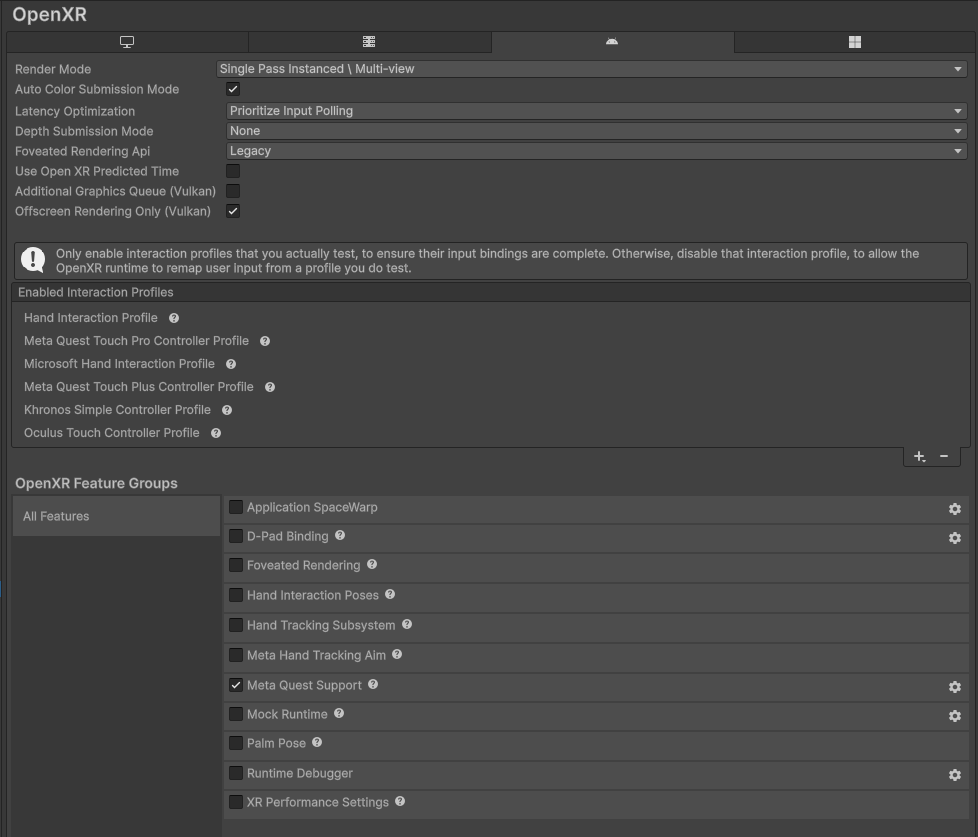
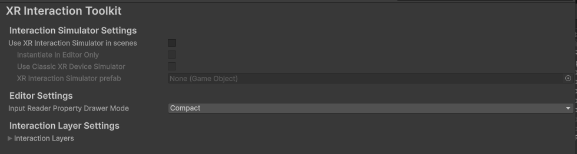

# Zombie Attack VR Multiplayer Game Readme
## Steps to Setup this project
1. Download the Unity 6000.2.5f1
2. Include the Android modules in the installation with the version
3. Open the Project and switch platform to Android in the Build Profiles window

## Configure Project Settings
1. Go to Edit -> Project Settings
2. In XR Plug-in Management section, ensure to have the following checks
   1. In Windows, Mac and Linux Settings, check the "Initialize XR on Startup" and the Plug-in Provider "Oculus"
   2. In Android Settings, check the "Initialize XR on Startup" and the Plug-in Provider "Oculus"
3. Within the XR Plug-in Management section
   1. In the Oculus subsection, ensure to have the following configuration in Android settings

   2. In the OpenXR subsection, ensure to have the following configuration in Android settings

   3. In the XR Interaction Toolkit subsection, ensure to have the following configuration in Android settings
